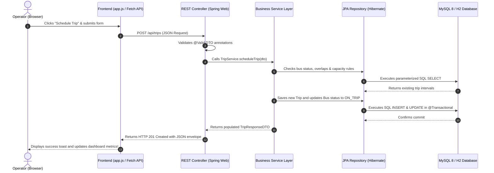

# BusWise: Intelligent Bus Transport Management System
> **RE:ENGINEERING INDIA'S BUS TRANSPORT SYSTEM**  
> *A full-stack, beginner-friendly transport operations platform built with Java 21, Spring Boot 3, MySQL 8.x, Bootstrap 5, and Chart.js.*

---

## 1. Project Overview & Problem Statement

Public and private bus operators in India (e.g. KSRTC, BMTC, MSRTC, and private express operators) often struggle with fragmented visibility across:
1. **Fleet Availability:** Buses scheduled while in maintenance, or unscheduled downtime.
2. **Route Performance & Demand:** Overloaded commuter runs alongside underutilized empty buses.
3. **Fuel Consumption & Costs:** Inefficient engines leaking profits with no proactive anomaly detection.
4. **Trip Economics:** Confusion between gross revenues and net operating margins after fuel, tolls, and maintenance.
5. **Environmental Impact:** Lack of transparency on vehicle emissions and benefits of electric fleet adoption.

**BusWise** solves this challenge through a centralized, web-based management portal. It connects scheduling, dispatching, fuel telemetry, passenger occupancy, and expense logs into a single reactive operational dashboard.

---

## 2. Technology Stack

### Frontend
- **HTML5 & CSS3:** Semantic markup with a clean, responsive navy-blue (`#0F2027`) transport design system.
- **JavaScript (Vanilla ES6+):** Pure browser standards with the `Fetch API` for REST communication (no bulky front-end node frameworks).
- **Bootstrap 5.3:** Modern responsive grid, modals, badges, cards, and accessibility.
- **Chart.js:** Responsive visual analytics for financial breakdowns, fuel trajectories, and fleet status.

### Backend
- **Java 21 (or compatible installed JDK):** Clean object-oriented architecture.
- **Spring Boot 3.3.4:** High-performance REST APIs and static resource web server running on port `8080`.
- **Spring Data JPA & Hibernate ORM:** Relational mappings, automated queries, and transaction management (`@Transactional`).
- **Jakarta Bean Validation:** Strict server-side input validation and error rejection.
- **Apache Maven 3.9+:** Automated dependency resolution and lifecycle management (wrapper script `mvnw.cmd` included).

### Database
- **MySQL 8.x (Production/College Demo):** Relational schema with primary keys, foreign keys, `CHECK` constraints, unique keys, and B-Tree indexes.
- **H2 Persistent Dev Mode:** Built-in zero-setup fallback profile for instant testing without manual MySQL server installation.

---

## 3. Architecture & Directory Structure

BusWise strictly enforces separation of concerns across clean Java packages:

```
BusWisse/
├── src/
│   ├── main/
│   │   ├── java/com/example/buswise/
│   │   │   ├── BusWiseApplication.java       # Spring Boot main entry point
│   │   │   ├── config/                       # WebConfig (CORS, static handlers)
│   │   │   ├── controller/                   # REST API Controllers (@RestController)
│   │   │   │   ├── BusController.java
│   │   │   │   ├── RouteController.java
│   │   │   │   ├── TripController.java
│   │   │   │   ├── FuelController.java
│   │   │   │   ├── ExpenseController.java
│   │   │   │   ├── DashboardController.java
│   │   │   │   ├── AnalyticsController.java
│   │   │   │   ├── AlertController.java
│   │   │   │   └── ReportController.java
│   │   │   ├── dto/                          # Request/Response Data Transfer Objects
│   │   │   ├── entity/                       # JPA Database Entities & Enums
│   │   │   │   ├── Bus.java
│   │   │   │   ├── Route.java
│   │   │   │   ├── Trip.java
│   │   │   │   ├── FuelRecord.java
│   │   │   │   ├── Expense.java
│   │   │   │   └── OperationalAlert.java
│   │   │   ├── exception/                    # Global Exception Handler & ErrorResponse
│   │   │   ├── repository/                   # Spring Data JPA Repository Interfaces
│   │   │   └── service/                      # Business Logic, Calculations & Rules
│   │   │       ├── BusService.java
│   │   │       ├── RouteService.java
│   │   │       ├── TripService.java
│   │   │       ├── FuelService.java
│   │   │       ├── ExpenseService.java
│   │   │       ├── AnalyticsService.java
│   │   │       ├── AlertService.java
│   │   │       └── DataInitializerService.java
│   │   └── resources/
│   │       ├── application.properties        # Main Spring Boot configuration
│   │       ├── application-dev.properties    # Zero-setup local persistent profile
│   │       ├── application-mysql.properties  # MySQL 8.x database profile
│   │       └── static/                       # Web UI served directly from port 8080
│   │           ├── index.html                # Single-page operations portal
│   │           ├── css/style.css             # Transport management styling
│   │           └── js/
│   │               ├── api.js                # Fetch API client & Toast notifications
│   │               └── app.js                # SPA navigation & Chart.js controllers
│   └── test/java/com/example/buswise/        # Automated JUnit 5 & MockMvc tests
├── database/
│   ├── schema.sql                            # Full MySQL 8.x DDL with indexes & checks
│   └── sample-data.sql                       # Seed data for Indian transport corridors
├── docs/
│   ├── database-design.md                    # Detailed ER diagram & data dictionary
│   └── api-documentation.md                  # Complete REST API reference
├── mvnw.cmd                                  # Windows Maven wrapper
├── pom.xml                                   # Maven dependencies & plugins
└── README.md
```

---

## 4. Beginner's Learning Guide: How the System Works

As an IT student learning full-stack development, here is how a user request flows through the entire system:



### Key Business Rules Enforced in Java:
1. **Overlap Prevention (`TripService.java`):** A bus cannot be scheduled for two trips whose active time windows intersect.
2. **Maintenance Safeguard (`TripService.java`):** A bus currently in `MAINTENANCE` status is strictly rejected from new trip scheduling.
3. **Passenger Capacity Rule (`TripService.java`):** Passenger count cannot exceed `bus.seatingCapacity` unless an explicit `overloadException` flag and documented reason are provided.
4. **Safe Deletion Policy (`BusService.java`):** A vehicle cannot be deleted if it has historical trips, refueling records, or expenses linked to it.
5. **No Double Counting (`AnalyticsService.java`):** Fuel costs and trip-level operational expenses are cleanly partitioned to ensure accurate net profit calculations without duplicate deductions.
6. **Carbon Footprint Calculation (`AnalyticsService.java`):** Tailpipe \(CO_2\) emissions are computed using the automotive benchmark:
   $$\text{Emissions (kg } CO_2) = \text{Fuel Consumed (L)} \times 2.68 \text{ kg } CO_2\text{/L}$$

---

## 5. Prerequisites & Environment Setup

### Prerequisites:
1. **Java Development Kit (JDK):** Java 21, 22, 23, or 26 installed. (Verify with `java -version`).
2. **MySQL 8.x (Optional for demo mode):** Running on port `3306` with user `root`.

---

## 6. How to Run the Application

The project includes an embedded Maven wrapper and a zero-configuration persistent storage profile, meaning **you can run the entire application right out of the box with zero external configuration!**

### Step 1: Clone / Open Project Directory
Open PowerShell or Command Prompt in the project folder:
```powershell
cd s:\BusWisse
```

### Step 2: Launch the Spring Boot Server
Run the local wrapper:
```powershell
.\mvnw.cmd spring-boot:run
```

*Note: On first launch, the application automatically seeds realistic Indian bus transport sample data (Volvo luxury coaches, Delhi-Agra, Bangalore-Mysuru, and Mumbai-Pune express corridors).*

### Step 3: Access the Portal
Open your browser and navigate to:
```
http://localhost:8080
```

### (Optional) Running with MySQL 8.x:
If you have MySQL 8.x installed and running on your machine:
1. Create the database using `database/schema.sql` (or allow Spring Boot to auto-create it):
   ```sql
   CREATE DATABASE buswise_db;
   ```
2. Run the application with the MySQL profile:
   ```powershell
   .\mvnw.cmd spring-boot:run -Dspring-boot.run.profiles=mysql
   ```

---

## 7. How to Run Automated Tests

To run the JUnit 5 test suite (testing overlapping trip prevention, capacity validation, duplicate registration checks, and MockMvc REST endpoints):
```powershell
.\mvnw.cmd test
```

Expected result:
```
[INFO] Results:
[INFO] Tests run: 12, Failures: 0, Errors: 0, Skipped: 0
[INFO] BUILD SUCCESS
```

---

## 8. Summary of Application Modules

| Module | Description | Key Features |
|---|---|---|
| **1. Dashboard** | Real-time Operations Center | Real database metrics, revenue vs expenses chart, bus status doughnut, active alerts count. |
| **2. Bus Fleet** | Vehicle Management | Full CRUD, registration uniqueness, odometer tracking, capacity validation, safe delete. |
| **3. Route Corridors** | Network Management | Origin/destination terminals, distance, transit duration, linked trip statistics. |
| **4. Trip Dispatch** | Dispatch & Lifecycle | Schedule trips, start/complete transitions, passenger counts, fare revenues, overlap prevention. |
| **5. Passenger Demand** | Capacity Analytics | Seat occupancy rate %, high-demand vs underutilized corridors, automated frequency recommendations. |
| **6. Fuel & Efficiency** | Energy & Fleet Health | Fuel logs, km/L benchmarks, threshold warnings (&lt; 3.8 km/L), fuel cost rollup. |
| **7. Expenses & Profit** | Operational Economics | Net operating profit = Ticket revenue − (Fuel + Tolls + Maintenance). Route-level margins. |
| **8. Sustainability** | Carbon Footprint | \(CO_2\) emissions estimation (\(2.68\text{ kg/L}\)), electric vehicle avoided emissions, green pathways. |
| **9. Operational Alerts** | Proactive Warning Engine | Rules-based alerts for overdue maintenance, fuel drops, low occupancy, and capacity overloads. |
| **10. Reports & Exports**| Data Extraction | One-click CSV downloads for Buses, Trips, Fuel, and Expenses, plus printable sheets. |

---

## 9. Known Limitations & Future Enhancements

- **Simulated Fleet Data:** This version uses manually entered and simulated telemetry rather than live OBD-II/GPS hardware trackers. (Clearly designated in documentation).
- **Authentication:** Authentication is currently open for local college lab demonstrations. In production, implement Spring Security with JWT tokens and role-based access control (`ROLE_DISPATCHER`, `ROLE_ADMIN`, `ROLE_AUDITOR`).
- **Real-Time GPS Tracking:** Future iterations can integrate Leaflet.js / OpenStreetMap with WebSocket streams to visualize simulated live moving buses along highway coordinates.
