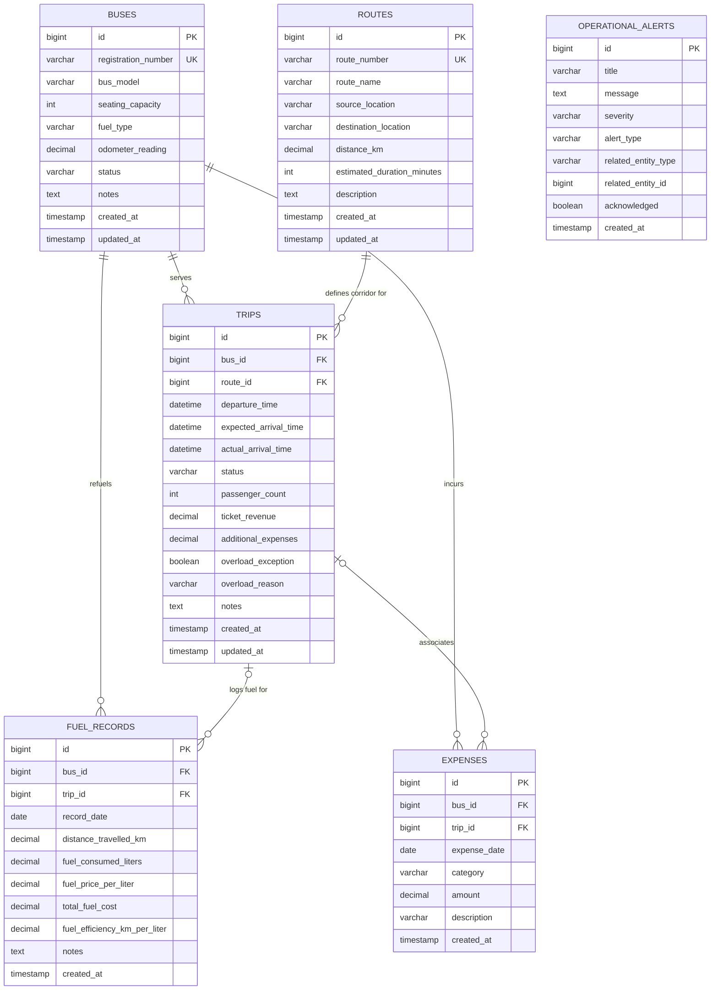

# BusWise Relational Database Design Documentation

## 1. Overview and Architecture Principles

The **BusWise** relational database schema is designed according to **Third Normal Form (3NF)** principles for MySQL 8.x. It models the core operational entities required to manage a modern intercity and regional bus transit fleet:
- Vehicles (`buses`)
- Transit corridors (`routes`)
- Scheduled and completed runs (`trips`)
- Refueling events & telemetry (`fuel_records`)
- Categorized expenditures (`expenses`)
- Rules-derived proactive notifications (`operational_alerts`)

### Key Design Tenets:
1. **Referential Integrity**: Foreign keys enforce strict parent-child relationships (e.g. trips cannot reference non-existent buses or routes).
2. **Safe Deletion Policy**: `ON DELETE RESTRICT` is enforced on `trips` to prevent accidental loss of operational history when managing buses or routes.
3. **No Redundant Derived Storage**: Aggregated dashboard statistics (such as total fleet revenue, fleet occupancy rate, or average km/L) are computed dynamically via repository queries to avoid desynchronization anomalies.
4. **Data Integrity Constraints**: Strict SQL `CHECK` constraints prevent negative monetary amounts, negative passenger counts, invalid fuel types, or non-positive capacities.

---

## 2. Entity-Relationship (ER) Diagram

---

## 3. Detailed Data Dictionary

### Table: `buses`
| Column | Type | Constraints | Description |
|---|---|---|---|
| `id` | `BIGINT` | PRIMARY KEY, AUTO_INCREMENT | Unique vehicle ID |
| `registration_number` | `VARCHAR(30)` | NOT NULL, UNIQUE | Vehicle number (e.g. `KA-01-F-9001`) |
| `bus_model` | `VARCHAR(100)` | NOT NULL | Chassis & body specification |
| `seating_capacity` | `INT` | NOT NULL, `CHECK > 0` | Licensed passenger seat capacity |
| `fuel_type` | `VARCHAR(20)` | NOT NULL, `IN ('DIESEL','CNG','ELECTRIC','PETROL')` | Powertrain propulsion |
| `odometer_reading` | `DECIMAL(10,2)` | NOT NULL, `CHECK >= 0` | Total kilometers driven |
| `status` | `VARCHAR(20)` | NOT NULL, `IN ('AVAILABLE','ON_TRIP','MAINTENANCE')` | Current availability status |
| `notes` | `TEXT` | NULL | Telemetry notes or maintenance remarks |
| `created_at` | `TIMESTAMP` | DEFAULT CURRENT_TIMESTAMP | Record creation timestamp |
| `updated_at` | `TIMESTAMP` | ON UPDATE CURRENT_TIMESTAMP | Last modified timestamp |

### Table: `routes`
| Column | Type | Constraints | Description |
|---|---|---|---|
| `id` | `BIGINT` | PRIMARY KEY, AUTO_INCREMENT | Unique route corridor ID |
| `route_number` | `VARCHAR(50)` | NOT NULL, UNIQUE | Route code (e.g. `RT-KA-101`) |
| `route_name` | `VARCHAR(150)` | NOT NULL | Display name (e.g. `Bangalore - Mysuru Expressway`) |
| `source_location` | `VARCHAR(120)` | NOT NULL | Origin terminal station |
| `destination_location` | `VARCHAR(120)` | NOT NULL | Destination terminal station |
| `distance_km` | `DECIMAL(8,2)` | NOT NULL, `CHECK > 0` | Total corridor road distance in km |
| `estimated_duration_minutes` | `INT` | NOT NULL, `CHECK > 0` | Scheduled transit time in minutes |
| `description` | `TEXT` | NULL | Road terrain or highway details |

### Table: `trips`
| Column | Type | Constraints | Description |
|---|---|---|---|
| `id` | `BIGINT` | PRIMARY KEY, AUTO_INCREMENT | Unique trip schedule run ID |
| `bus_id` | `BIGINT` | FOREIGN KEY (`buses.id`), NOT NULL | Assigned vehicle |
| `route_id` | `BIGINT` | FOREIGN KEY (`routes.id`), NOT NULL | Assigned corridor |
| `departure_time` | `DATETIME` | NOT NULL | Scheduled departure time |
| `expected_arrival_time` | `DATETIME` | NOT NULL | Scheduled arrival time |
| `actual_arrival_time` | `DATETIME` | NULL | Timestamp of actual completion |
| `status` | `VARCHAR(20)` | NOT NULL, `IN ('SCHEDULED','IN_PROGRESS','COMPLETED','CANCELLED')` | Dispatch lifecycle state |
| `passenger_count` | `INT` | NOT NULL, DEFAULT 0, `CHECK >= 0` | Passengers carried |
| `ticket_revenue` | `DECIMAL(10,2)` | NOT NULL, DEFAULT 0.00, `CHECK >= 0` | Gross fare collected in INR |
| `additional_expenses` | `DECIMAL(10,2)` | NOT NULL, DEFAULT 0.00, `CHECK >= 0` | Tolls, permits or trip-specific charges |
| `overload_exception` | `BOOLEAN` | NOT NULL, DEFAULT FALSE | Explicit flag if passengers > capacity |
| `overload_reason` | `VARCHAR(255)`| NULL | Operational reason for passenger overload |

### Table: `fuel_records`
| Column | Type | Constraints | Description |
|---|---|---|---|
| `id` | `BIGINT` | PRIMARY KEY, AUTO_INCREMENT | Refueling event ID |
| `bus_id` | `BIGINT` | FOREIGN KEY (`buses.id`), NOT NULL | Refueled vehicle |
| `trip_id` | `BIGINT` | FOREIGN KEY (`trips.id`), NULL | Optional associated trip run |
| `record_date` | `DATE` | NOT NULL | Date of refueling |
| `distance_travelled_km` | `DECIMAL(8,2)` | NOT NULL, `CHECK >= 0` | Kilometers logged since last fill |
| `fuel_consumed_liters` | `DECIMAL(8,2)` | NOT NULL, `CHECK > 0` | Liters or kWh equivalent dispensed |
| `fuel_price_per_liter` | `DECIMAL(8,2)` | NOT NULL, `CHECK >= 0` | Fuel price per liter (INR) |
| `total_fuel_cost` | `DECIMAL(10,2)`| NOT NULL | `fuel_consumed_liters * fuel_price_per_liter` |
| `fuel_efficiency_km_per_liter`| `DECIMAL(8,2)`| NOT NULL | `distance_travelled_km / fuel_consumed_liters` |

### Table: `expenses`
| Column | Type | Constraints | Description |
|---|---|---|---|
| `id` | `BIGINT` | PRIMARY KEY, AUTO_INCREMENT | Expense voucher ID |
| `bus_id` | `BIGINT` | FOREIGN KEY (`buses.id`), NULL | Optional bus association |
| `trip_id` | `BIGINT` | FOREIGN KEY (`trips.id`), NULL | Optional trip run association |
| `expense_date` | `DATE` | NOT NULL | Date incurred |
| `category` | `VARCHAR(30)` | NOT NULL | `FUEL`, `MAINTENANCE`, `DRIVER_SALARY`, `TOLL`, `PERMIT`, `MISC` |
| `amount` | `DECIMAL(10,2)` | NOT NULL, `CHECK >= 0` | Expenditure amount in INR |
| `description` | `VARCHAR(255)` | NOT NULL | Justification / item note |

### Table: `operational_alerts`
| Column | Type | Constraints | Description |
|---|---|---|---|
| `id` | `BIGINT` | PRIMARY KEY, AUTO_INCREMENT | Alert notification ID |
| `title` | `VARCHAR(150)` | NOT NULL | Short alert summary |
| `message` | `TEXT` | NOT NULL | Detailed explanation and rule context |
| `severity` | `VARCHAR(20)` | NOT NULL, `IN ('INFO','WARNING','CRITICAL')` | Severity level |
| `alert_type` | `VARCHAR(50)` | NOT NULL | Rule classification |
| `related_entity_type` | `VARCHAR(30)` | NULL | `BUS`, `ROUTE`, `TRIP` |
| `related_entity_id` | `BIGINT` | NULL | Identifier of triggering entity |
| `acknowledged` | `BOOLEAN` | NOT NULL, DEFAULT FALSE | Whether an operator has cleared it |

---

## 4. Indexing Strategy

To guarantee high sub-second query performance during live dashboard updates and large table paginations:

1. **`idx_bus_registration`** (`buses(registration_number)`): Enables instantaneous uniqueness checks and case-insensitive searching.
2. **`idx_trip_bus_time`** (`trips(bus_id, departure_time, expected_arrival_time)`): Critical compound index used by the scheduling engine to detect overlapping trips in \(O(1)\) time.
3. **`idx_route_number`** (`routes(route_number)`): Fast lookups for route codes.
4. **`idx_fuel_bus`** & **`idx_fuel_date`**: Accelerates vehicle efficiency rollups and monthly fuel consumption graphs.
5. **`idx_alert_severity`** & **`idx_alert_acknowledged`**: Speeds up active notification bell counts on the top navigation bar.
